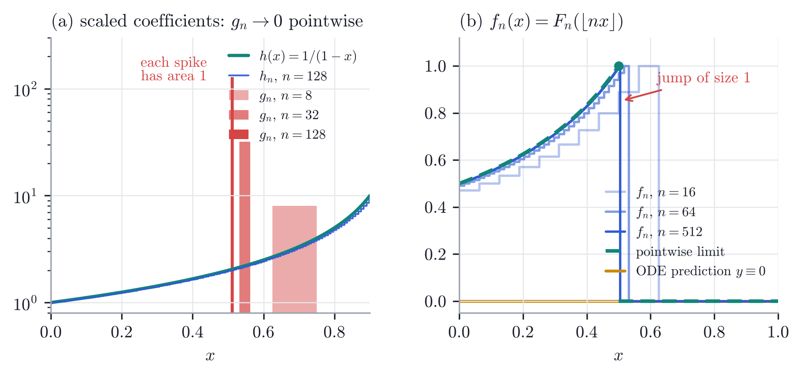
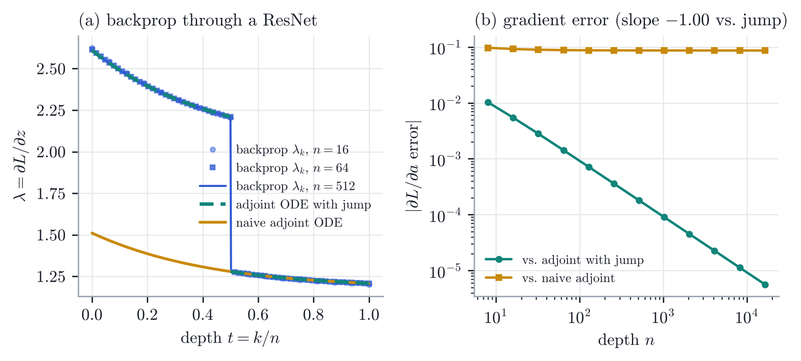

# Moving spikes and measure-valued limits of backward recurrences

**Principia Fall Competition 2026 · MATHDB 354674 · Adib Alqurashi (KFUPM)**

This repository holds my entry in the [Principia](https://principia-math.com) Fall Competition 2026. The project starts from [MATHDB problem 354674](https://mathdb.com/p/354674), Conjecture 1 of Bayón, Fortuny Ayuso, Grau, Oller-Marcén and Ruiz (2023), which asks when a backward recursion converges to the ODE it is meant to discretise. It carries the problem through all five Principia stages.

| Stage | Where |
|---|---|
| 1. Solution | Principia's AI-generated counterexample ([MathDB 354674](https://mathdb.com/p/354674)) |
| 2. Lean formalization | [`Problem354674.lean`](https://github.com/PrincipiaMathOrg/math-solutions/blob/main/mathdb/Principia/MathDB/Problem354674.lean) in PrincipiaMathOrg/math-solutions |
| 3. Paper | [`paper/paper.pdf`](paper/paper.pdf) (14 pages; LaTeX source in [`paper/`](paper)) |
| 4. Exposition | [`exposition/`](exposition): a 94 s animation and a 15-slide deck with speaker notes |
| 5. Potential applications | [`applications/applications.pdf`](applications/applications.pdf) (7 pages) |

## The result in one picture

The recursion $F_n(k)=G_n(k)+H_n(k)F_n(k+1)$ is an Euler scheme for $y'=-g+hy$, with $g_n=nG_n$ and $h_n=n(1-H_n)$. The conjecture asks whether pointwise convergence of $g_n$ and $h_n$ is enough. It is not. A single unit spike at index $\lfloor n/2\rfloor+1$ has height $n$ and width $1/n$, so $g_n\to0$ pointwise while its area stays $1$, and the recursion converges to a function with a **jump** instead of the ODE solution $y\equiv 0$.



## What this project adds

- **A measure-valued limit theorem (Theorem 4).** Suppose $h_n\to h$ uniformly, $G_n\ge0$, the forcing measures $\nu_n=\sum_k G_n(k)\delta_{k/n}$ converge weakly to $\nu$, and the terminal values converge to $\Theta$. Then at every non-atom $x$ of $\nu$,
  $$f_n(x)\to f(x)=\int_{[x,b]}\Phi(x,s)\,d\nu(s)+\Theta\,\Phi(x,b),\qquad \Phi(x,s)=e^{-\int_x^s h}.$$
  Each atom of $\nu$ becomes a jump of exactly its size.
- **Consequences:**
  - Under uniform integrability of $g_n$ the classical ODE limit comes back (Corollary 7).
  - Spikes at a fixed index wash out, while spikes at a fixed relative position survive (Corollary 8).
  - The counterexample's limit is recovered (Example 9).
- **Six numerical experiments:** an exact rational check, $O(1/n)$ rates, a generic test with smooth forcing plus two moving spikes, smoothing, and fixed-versus-moving spikes.
- **Scientific machine learning:**
  - Backpropagation through a ResNet $z_{k+1}=z_k+v(z_k)/n$ is exactly this recursion for $\lambda_k=\partial L/\partial z_k$.
  - An intermediate (deep-supervision) loss is a moving spike, so the neural-ODE adjoint must jump (Proposition 10).
  - In the experiment, dropping the jump changes $\partial L/\partial\alpha$ from $0.2668$ to $0.1801$, a 32.5% error.



## Reproduce

```bash
cd code
python3 experiments.py      # all experiments -> ../results.json and ../figures/
python3 make_numbers.py     # numbers quoted in the paper -> ../paper/numbers.tex
cd ../paper && pdflatex paper.tex && pdflatex paper.tex
cd ../applications && pdflatex applications.tex && pdflatex applications.tex
cd ../exposition/anim && python3 make_animation.py video ../animation.mp4
```

You'll need Python 3 with numpy, scipy and matplotlib, a TeX distribution, and ffmpeg for the video.

## Repository layout

```
paper/          the paper (PDF + LaTeX)
applications/   potential-applications note (PDF + LaTeX)
exposition/     animation.mp4, slides/ (PPTX + PDF), anim/ (animation source)
code/           recurrence.py (solver), experiments.py (all experiments + figures), make_numbers.py
figures/        paper/ (vector PDF), light/ and dark/ (PNG)
results.json    every number quoted in the paper
```

## Credits

- **Conjecture:** L. Bayón, P. Fortuny Ayuso, J. M. Grau, A. M. Oller-Marcén, M. M. Ruiz, *A new method for computing asymptotic results in optimal stopping problems*, Bull. Malays. Math. Sci. Soc. **46** (2023), article 46.
- **Counterexample and its Lean formalization:** Principia Math in Progress (2026), MathDB 354674, and PrincipiaMathOrg/math-solutions.
- **This repository:** the measure-valued limit theorem and its consequences, the experiments, the residual-network connection, the exposition and the applications note.

Code is released under the MIT License (see `LICENSE`). The paper, notes, slides and video are released under CC BY 4.0.
