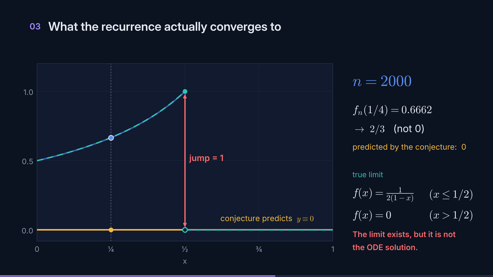

# Exposition

These explain the result and the idea behind its proof for someone outside the area.

- **[animation.mp4](animation.mp4)** (94 s, 1080p). The recurrence, the moving spike, the jump, the measure-valued fix, and what it means for backpropagation through ResNets. [Direct download](animation.mp4?raw=true).
- **[Slides (PDF)](slides/principia_354674_exposition.pdf)** and the **[PowerPoint version](slides/principia_354674_exposition.pptx)**: 15 slides with speaker notes. The animation is embedded on slide 12 of the PowerPoint.
- **[anim/make_animation.py](anim/make_animation.py)**: the source of the animation, written in matplotlib. Run `python3 make_animation.py video out.mp4`.

